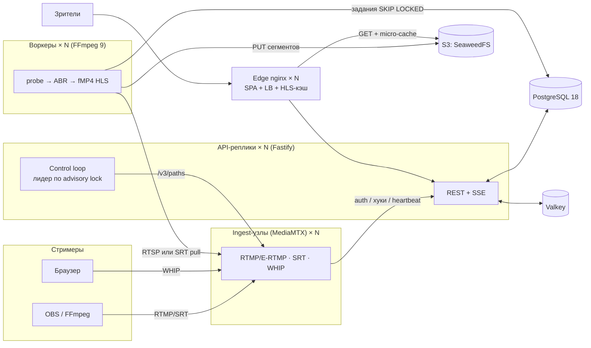
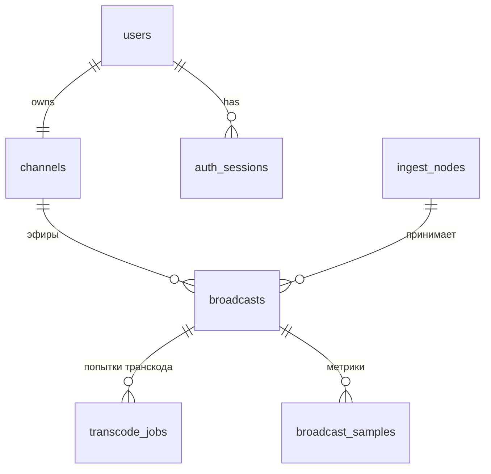
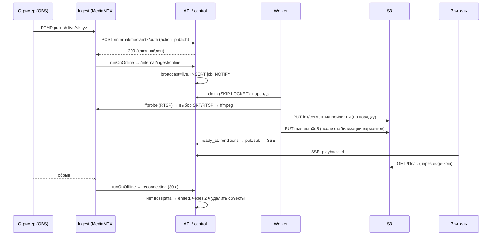

# Архитектура StreamHub

StreamHub — открытый «мини-Twitch»: много стримеров одновременно, приём в разных
протоколах и кодеках, адаптивная раздача зрителям через HLS. Документ описывает
устройство системы, принятые решения и поведение при отказах.

## Компоненты

| Компонент | Технология | Состояние | Масштабирование |
|---|---|---|---|
| **ingest** | MediaMTX 1.21 + скрипты-обвязки | только живые соединения | горизонтально, L4-балансировщик / GeoDNS |
| **srt-gateway** | Go + gosrt + FFmpeg (remux) | только живые соединения | рядом с каждым ingest-узлом |
| **api** | Node 24 + Fastify 5, TypeScript без сборки | нет (stateless) | горизонтально за edge |
| **control loop** | внутри api, один лидер | нет (всё в Postgres) | автоматический перевыбор лидера |
| **worker** | Node 24 + статический FFmpeg 9 | нет (аренда заданий) | горизонтально, по CPU/GPU |
| **edge** | nginx 1.30 | кэш сегментов | горизонтально, CDN поверх |
| **postgres** | PostgreSQL 18 | источник истины | реплики / Patroni / managed |
| **valkey** | Valkey 9 (BSD-форк Redis) | эфемерное | Sentinel/Cluster; при отказе — деградация |
| **object storage** | SeaweedFS 4 (S3 API) | HLS-объекты | кластер SeaweedFS или любой S3 |

## Ключевые решения

**1. MediaMTX вместо node-media-server.** Старый `node-media-server` v2 не развивается,
поддерживает только H.264 по RTMP, а SRT был реализован отдельным ffmpeg на порт для
каждого ключа. MediaMTX — зрелый медиасервер на Go: Enhanced RTMP (H.264/H.265/AV1/VP9),
SRT с мультиплексированием по `streamid` (один порт на всех), WHIP (WebRTC из браузера и
OBS ≥ 30), HTTP-авторизация, хуки и control API. Это устраняет порт-на-ключ и даёт
новые кодеки без собственного медиакода.

**1a. Универсальный SRT-вход.** Родной SRT MediaMTX понимает только MPEG-TS с H.264/H.265,
а AV1/VP9 в MPEG-TS не стандартизированы (FFmpeg не читает их даже из собственного вывода;
OBS 33 по SRT шлёт только H.264/HEVC). Шлюз `srt-gateway` принимает SRT на одном порту для всех
ключей (`streamid`), авторизует публикацию тем же хуком control plane и, на каждое подключение,
запускает FFmpeg с автоопределением контейнера (Matroska/WebM, FLV, MPEG-TS…). Поток копируется
без перекодирования в MediaMTX по RTSP (там есть AV1/VP9/VP8) с меткой `via=srt` для статистики.

**2. Ingest и транскодирование разделены.** Ingest только принимает поток. Тяжёлое
кодирование выполняют отдельные воркеры, которые забирают поток по внутренней сети.
Поэтому они масштабируются и падают независимо: смерть воркера не рвёт соединение
стримера, а падение ingest-узла не трогает чужие транскоды.

**3. Очередь заданий на PostgreSQL (`FOR UPDATE SKIP LOCKED` + аренда).** Отдельный
брокер не нужен. Задание `transcode_jobs` берётся атомарно, воркер продлевает аренду
каждые 3 с. Если аренда истекла (воркер умер или завис), задание сразу доступно другому
воркеру. При потере связи с БД воркер сам останавливает ffmpeg (fencing), чтобы не было
двух писателей одного потока. Новые задания будятся через `LISTEN/NOTIFY`.

**4. Источник без перекодирования + H.264-лестница.** Поток H.264/HEVC/AV1 отдаётся
зрителям как есть (вариант `source`: без потерь качества и затрат CPU). Ниже разрешения
источника строится H.264-лестница 1080/720/480/360/160, без апскейла; ≤480p ограничены
30 fps, вертикальное видео считается по короткой стороне. Для не-H.264 источника
добавляется H.264-копия в его разрешении, чтобы посмотреть мог любой браузер. hls.js сам
отбрасывает варианты, кодек которых браузер не декодирует (`CODECS` в master-плейлисте
мы формируем сами по RFC 6381). Первым в master стоит H.264-вариант около 720p:
быстрый и совместимый старт.

**5. Транспорт от ingest к воркеру выбирается по кодеку.** RTP (RTSP) не несёт DTS. При
копировании H.264/H.265 с B-кадрами это даёт битые временные метки. Поэтому такие потоки
воркер читает по SRT (MPEG-TS, где MediaMTX восстанавливает DTS), а AV1/VP9/VP8 — по RTSP.

**6. CMAF/fMP4 HLS в объектное хранилище, раздача через кэширующий edge.** ffmpeg
отправляет сегменты по HTTP PUT в локальный приёмник воркера. Тот асинхронно выгружает
их в S3, соблюдая порядок внутри варианта: плейлист никогда не появляется раньше своих
сегментов. Edge-nginx отдаёт `/hls/*` из S3 с micro-cache: плейлисты 1 с +
`proxy_cache_lock`, то есть ~1 запрос в секунду к хранилищу на edge при любом числе
зрителей; сегменты иммутабельны. Поверх можно поставить любой CDN (`PUBLIC_HLS_BASE`).

**7. Мягкая деградация вместо очереди.** Если свободных слотов полного транскодирования
нет дольше 8 с, задание берётся в режиме `degraded`: только remux исходника плюс одна
H.264 ≤480p для не-H.264 источников. Зритель видит эфир сразу, а не ждёт освобождения мощностей.

**8. Уровневая (level-triggered) сверка.** Хуки MediaMTX (`runOnOnline/Offline`) дают
мгновенную реакцию, но могут потеряться. Лидер control loop каждые 2 с сверяет фактическое
состояние ingest-узлов (`/v3/paths/list`) с БД: досоздаёт пропущенные эфиры, закрывает
исчезнувшие, переназначает задания и пересоздаёт упавшие. Система сходится к правильному
состоянию при любых потерях событий.

## Модель данных

- **broadcast** — один непрерывный эфир. Переживает переподключения стримера в течение
  30 с (`reconnecting`). Частичный уникальный индекс гарантирует не больше одного активного
  эфира на канал.
- **transcode_job** — транскод одного ingest-соединения. Не больше одного активного
  задания на эфир (тоже частичный уникальный индекс).
- Пароли — scrypt; сессии — случайный токен в HttpOnly-cookie, в БД хранится только SHA-256.
- Эфемерное (зрители, счётчики rate-limit, pub/sub) — в Valkey. Его потеря не ломает
  стриминг, только временно обнуляет счётчики зрителей.

## Жизненный цикл эфира

## Отказоустойчивость: что будет, если…

| Отказ | Обнаружение | Поведение | Время восстановления |
|---|---|---|---|
| Воркер упал (SIGKILL, OOM, хост) | аренда не продлевается | другой воркер забирает задание, нумерация сегментов продолжается (`epoch`), `EXT-X-DISCONTINUITY` | ≈ 10 с аренда + 3–5 с старт (в e2e: **18 с**) |
| Контейнер воркера перезапустился | при старте видит свои «осиротевшие» задания | возвращает их в очередь немедленно | ≈ 3–5 с |
| Воркер получил SIGTERM (деплой) | graceful shutdown | задания сразу отдаются в очередь (`not_before=now`) | ≈ 3–5 с |
| Нет свободных мощностей | задание ждёт > 8 с | режим `degraded`: исходник + H.264 ≤480p | 8 с |
| ffmpeg завис / нет сегментов | watchdog в воркере | перезапуск с бэкоффом 1–15 с; после 30 неудач `failed`, через 30 с control loop пересоздаёт | секунды |
| Потерян хук online/offline | сверка с `/v3/paths/list` каждые 2 с | состояние исправляется | ≤ 2 с |
| Ingest-узел умер | нет heartbeat 15 с + API недоступен | эфиры → `reconnecting`; OBS переподключается к другому узлу через LB → тот же эфир | время переподключения OBS |
| Стример переподключился | runOnOnline с новым source id | тот же broadcast, новое задание, плеер не теряет URL | секунды |
| API-реплика упала | healthcheck / nginx `max_fails` | edge повторяет запрос на другой реплике (`proxy_next_upstream`) | мгновенно |
| Лидер control loop упал | сессия Postgres закрылась → advisory lock свободен | другая реплика становится лидером | ≤ 3 с |
| Valkey недоступен | ошибки клиента | счётчики зрителей = 0, rate-limit открыт, SSE синхронизируется раз в 30 с; стриминг работает | после возврата |
| S3 медленный | очередь выгрузки растёт | ffmpeg не блокируется; предупреждение в логах | — |
| Edge-кэш пуст / S3 моргнул | `proxy_cache_use_stale` | отдаётся последний удачный ответ | — |

Плеер дополнительно защищён watchdog-ом: если `currentTime` не растёт 10 с при живом эфире,
плеер пересоздаётся из master-плейлиста.

## Масштабирование

- **Зрители.** Узкое место — трафик сегментов. Edge-реплики масштабируются горизонтально,
  каждая сама кэширует сегменты; плейлисты схлопываются `proxy_cache_lock`. Для интернет-
  масштаба ставится CDN (`PUBLIC_HLS_BASE=https://cdn…/hls`); origin — S3 или edge.
- **Стримеры.** Один MediaMTX держит сотни входящих потоков (ограничение — сеть). Узлы
  добавляются под L4-балансировщик (RTMP/TCP, SRT/UDP) и сами регистрируются heartbeat-ом.
- **Транскодирование.** Линейно по CPU/GPU: `WORKER_SLOTS` на воркер (1080p60-лестница на
  libx264 veryfast ≈ 4 ядра), NVENC/QSV определяются автоматически. Режим `passthrough`
  (или degraded) почти не требует CPU. Для отказоустойчивости держите запас **N+1**: при
  падении воркера его задания должны куда-то уместиться.
- **API.** Stateless; SSE масштабируется через Valkey pub/sub: событие → одна загрузка
  состояния на реплику → рассылка её клиентам.
- **БД.** Нагрузка — служебные запросы control loop (O(живые эфиры) раз в 2 с) и API.
  Горячий путь зрителя (heartbeat) идёт в Valkey с кэшем slug→broadcast на 5 с.

## Безопасность

- Ключи трансляции проверяются control plane на каждую публикацию. Чтение сырых потоков
  с ingest разрешено только воркерам (внутренний пользователь + секрет).
- `/internal/*`, `/metrics`, control API MediaMTX не проксируются наружу. Внутренние
  вызовы дополнительно подписаны `INTERNAL_SECRET`. В неlocalhost-развёртывании API
  откажется стартовать с секретом по умолчанию.
- CSRF: cookie `SameSite=Lax` + только `application/json` для изменяющих запросов +
  проверка `Origin`. Rate-limit на регистрацию, вход, heartbeat; nginx `limit_req`.
- Пароли: scrypt (N=2¹⁵); сессии: 256-битный токен, в БД — SHA-256.
- Объектное хранилище: анонимно доступен только `GetObject`; запись и листинг закрыты.

## Ограничения и развитие

- Чата нет (по ТЗ). Шина событий (Valkey pub/sub + SSE) готова для него.
- VOD/записи: сегменты эфира остаются в S3 `RETENTION_MINUTES`. Для VOD достаточно
  сохранять полный плейлист (`EXT-X-PLAYLIST-TYPE:EVENT`).
- LL-HLS / WebRTC-просмотр (WHEP) для задержки < 2 с — следующий шаг. Сейчас задержка
  ≈ 6–10 с (2-секундные сегменты).
- AV1/HEVC-лестница (не только H.264) — добавляется энкодером в `ladder.ts` при наличии GPU.
